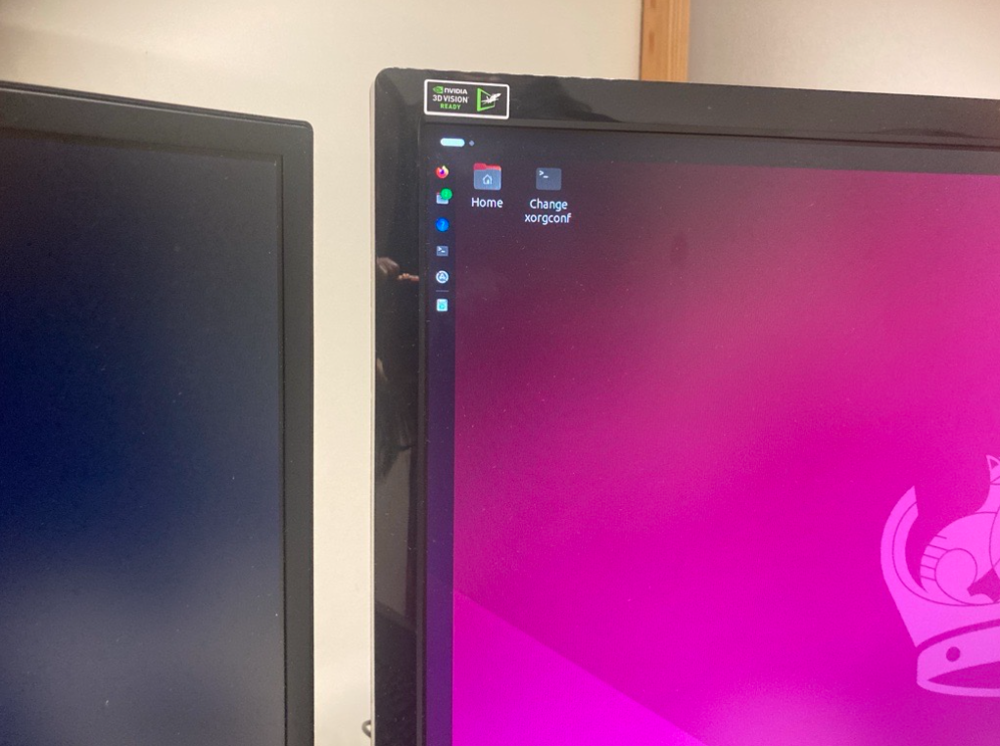

# Lab calendar

<https://sharepoint.uni-graz.at/sites/602/arbeitsbereiche/allgpsy/Lists/Audio%20und%20Wahrnehmungslabor/calendar.aspx>\

# Before the experiment

## Switching the equipment on

- Turn on two power splitters, one in the subject cabin and one in the experimenter control room

  - Make sure the big monitor inside the subject room is making noises. From this time onward it takes 20 minutes for it to reach a steady state (if you care/have color or luminance-sensitive experiments)

- Turn on the big black computer labelled "Linux" under the table

- Set the switch between the two monitors to "2" (position labelled "Linux")

- Log in as allg_user (password under the monitor)

- Set the relevant XOrg configuration by running the **Change xorgconf** script on the desktop:

  

  - For PsychoPy: the left screen (subject monitor) should show half of the desktop

  - For PsychToolbox: the left screen (subject monitor) is black if you are not running an experiment. This is normal\

# During the experiment

- Use the big black gaming keyboard to collect subject responses

- Ideally we should not move any equipment inside except for the chin rest and the chair

# After the experiment (important!)

- Shut down the Linux computer

- Turn off both power splitters
