# General information

Neurodesktop is a Linux environment specifically developed for open and reproducible neuroimaging. For details, see <https://www.neurodesk.org>.

This page provides information and instructions on how to use Neurodesk and Neurodesktop on our lab's server.

## Access

### Employees

Office computers and VPN with an employee account

### Non-employees (students and interns)

- Office computers

- Student PC room

## Resources

Resource limits depend on your role:

- **Admin / Instructor / Researcher**: up to 350 GB RAM and 30 CPU cores
- **Student**: up to 64 GB RAM and 6 CPU cores

When several people compute at the same time, they share the CPU cores, so programs run slower (see [Resource (esp. RAM) usage](#resource-esp.-ram-usage)).

Your home directory has a quota of 200 GB (students: 100 GB). This is a maximum, not a size to aim for: all home directories share one disk, so keep your home small and your data in your personal storage (see [Storing data]).

# Getting an account

1.  Use a computer with server access (described in [Access] section)

2.  Open a browser and type [https://pslg-nv1.uni-graz.at](https://pslg-nv1.uni-graz.at/)

3.  Select "sign up"

    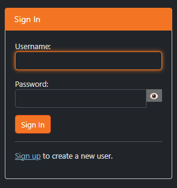

4.  Fill out the following fields

    - Username: first part of your university email account before "\@", e.g. jane.doe if your email address is jane.doe\@edu.uni-graz.at

    - Email: your university student or employee email address (if you are a course participant: university student email address)

    - Password of your choice

    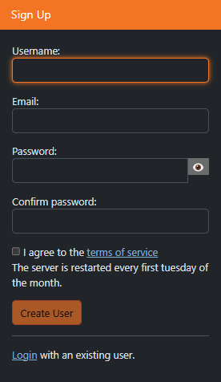

5.  After you sign up, your account needs to be authorized by the technical staff. This may take a few days. If there is no progress, please check back with us.

6.  Once your account is authorized, you should be able to log in with your credentials (you won't get any special notifications, so please just check regularly)

# Using Neurodesk

Once your account has been authorized

1.  Open a browser and type [https://pslg-nv1.uni-graz.at](https://pslg-nv1.uni-graz.at/)

2.  Sign in with your credentials

3.  Choose a Neurodesktop version (see [Choosing a version]) and start your server. The first start can take a few minutes (see [First usage]).

    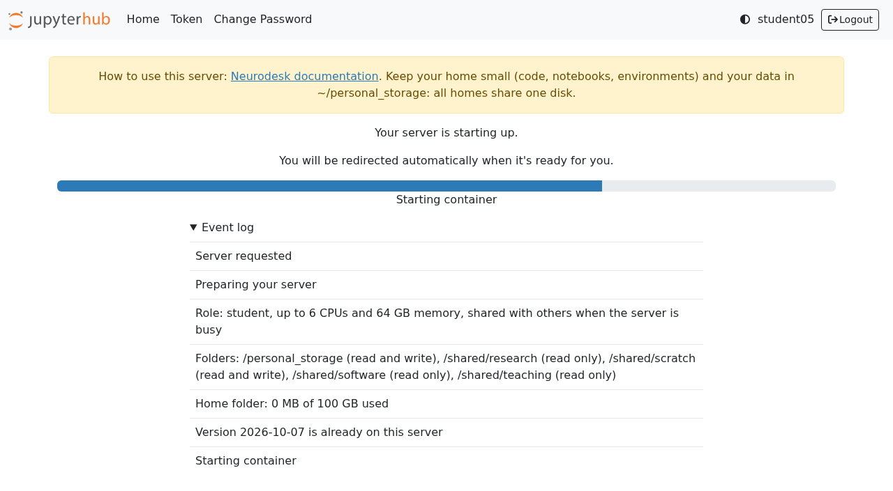{width="600"}

4.  You will see a JupyterLab session. In neurodesk everyone becomes a linux user "jovyan". Your home directory `/home/jovyan` will appear on the left hand side

5.  You can use the terminal or jupyter notebook directly in the browser by clicking the corresponding icons

6.  If you would like to use a graphical interface, start the Neurodesktop by clicking **Neurodesktop VNC**. The desktop adapts to the size of your browser window.

    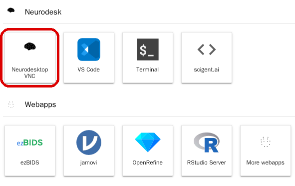{width="406"}

7.  You should see the desktop; all neuroimaging apps are in the start menu (bottom left) under Neurodesk:

    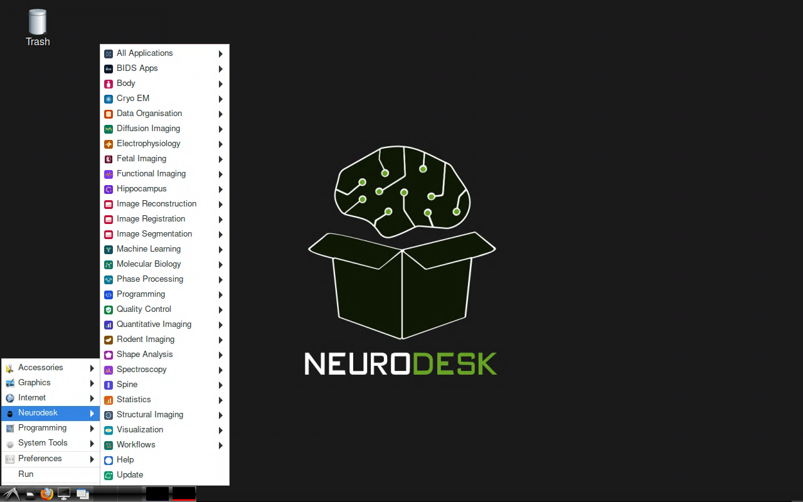{width="400"}

8.  If you close this window and reopen it later, everything is as you left it, unless the server has been restarted in the meantime (every first Tuesday of the month). A restart stops all running programs; your files stay. Idle notebooks are stopped after 24 hours, idle servers after 14 days.

You can use <https://pslg-nv1.uni-graz.at/hub/home> to control your container (start/stop) or change your password. You can also reach the hub home by choosing File -\> Hub Control Panel from the menu.

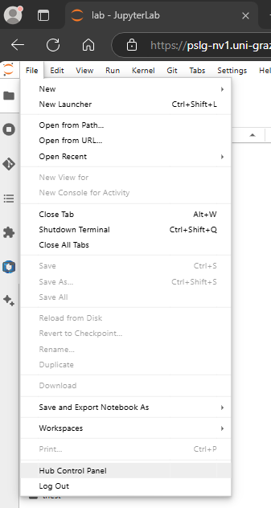

## Choosing a version

The start page offers three groups of versions (named by release date):

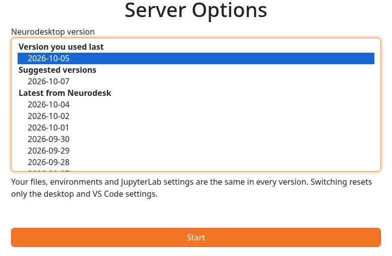{width="500"}

- **Version you used last**: preselected. Keep using it, especially within a running project.
- **Suggested versions**: tested on this server. Choose this if you are new.
- **Latest from Neurodesk**: newer releases. Try one only if you need something it brings; you can switch back at any time.

The version changes the desktop, JupyterLab and the base Python. The neuroimaging tools are the same in every version; you choose their version yourself, e.g. `ml freesurfer/7.4.1`. For reproducible analyses, write the tool versions into your scripts.

Switching versions keeps your files, environments and kernels; it resets the desktop and VS Code settings.

## First usage

The first time you start the neurodesk or a specific neurodesktop application, it may take a while until it opens. Be patient! This is because the first time everything gets downloaded in the background. It will be faster when you perform the same operation again.

## Storing data

You have two places of your own. Both are kept after a server restart:

- **Home directory** (`/home/jovyan`): fast, with a quota of 200 GB (students: 100 GB). For code, notebooks, Python environments and the data you are working on.
- **Personal storage** (`~/personal_storage`): large, without a quota. For bigger data sets and results you want to keep.

Files in `/shared` and on the network shares are kept too. Everything else (e.g. `/tmp`) is lost when your server stops.

Files you delete, in the JupyterLab file browser or with `rm`, are gone at once; there is no undo. The banner at the top of the hub pages warns you when your home directory is nearly full. If it is full, your server still starts, so you can delete files.

Admins, instructors and researchers can read your personal storage (see [Sharing data]). To keep something private: `chmod 600 <file>` or `chmod 700 <folder>`.

## Sharing data

Shared folders are under `/shared` (`~/shared` in your home is a link to it). Which ones you get depends on your role. Roles are assigned by an admin; without one you are a student.

| Folder | Admin | Instructor | Researcher | Student |
| --- | --- | --- | --- | --- |
| `/shared/research` | read/write | read/write | read/write | read only |
| `/shared/teaching` | read/write | read/write | read only | read only |
| `/shared/scratch` | read/write | read/write | read/write | read/write |
| `/shared/licenses` | read only | read only | read only | – |
| `/shared/software` (programs installed by the admins) | read only | read only | read only | read only |
| `/shared/people/<name>` (everyone's personal storage) | read only | read only | read only | – |

⚠ The content of `/shared/scratch` is deleted after 2 weeks.

Your own personal storage also appears under `/shared/people/<your name>`, but read only; write to it through `~/personal_storage`.

## Data transfer

There are currently these alternatives

1.  Drag files or folders from your computer into the JupyterLab file browser on the left, or use the "Upload Files" button at the top of it (up-pointing arrow). Download by right-clicking a file.

    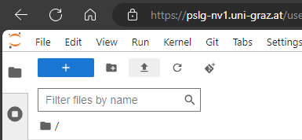

2.  Drag files onto the Neurodesktop desktop. They land in your personal storage (`~/personal_storage`). Folders do not work there: zip them first, or use the file browser (1.).

3.  The Nextcloud client in the Neurodesktop desktop, in the start menu under Accessories

    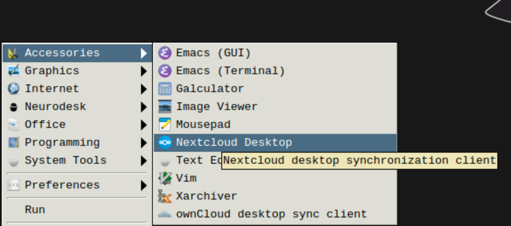{width="400"}

4.  Copy from or to the J and Y network shares, see [Mount network shares](#sec-mountNetwork).

5.  With ssh access to the server (lab members whose neurodesk username is their server login): copy with `scp` or `rsync` into your personal storage, `/storage/neurodesk/users/<your name>`.

## Mount network shares {#sec-mountNetwork}

The J and Y network shares can be mounted with your own university login, from a terminal in neurodesk:

1.  Mount both: `uni-mount`, then enter your university username and password when asked.\
    Only one: `uni-mount J` or `uni-mount Y`

2.  Shares

    - J $\to$ `//pslg067044.pers.ad.uni-graz.at/Allgemeine`, at `~/J_Allgemeine` (and `/mnt/J_Allgemeine`)
    - Y $\to$ `//pers.ad.uni-graz.at/fs/ou/602`, at `~/Y_602` (and `/mnt/Y_602`)

3.  The shares are there right away, also for the neuroimaging tools. Only you can see them; your password is not stored.\
    ⚠ Deleting files in `~/J_Allgemeine`, `~/Y_602` or `/mnt` (with `rm` or in the file browser) deletes them on the network share itself, for everyone, as far as your university account is allowed to.

4.  Other commands

    - `uni-mount --list` $\to$ shows which shares are mounted
    - `uni-mount --unmount` $\to$ unmounts both (`uni-mount --unmount J` only J)

Shares are unmounted when your server stops; mount them again after the next start.

## Software

### Installing software

There is no `sudo` and no `apt install` in neurodesk. Instead:

- neuroimaging tools: `ml av` lists them, `ml <tool>/<version>` loads one. The Neurodesk menu on the desktop is as new as the Neurodesktop version you chose; `ml av` also lists tools released since
- Python packages: best in a uv environment in your home, see [Persistent Python environments (uv / conda)](#persistent-python-environments-uv-conda)
- other programs: as an Apptainer/Singularity image, see [Other docker-based software]
- programs the admins installed for everyone are in `/shared/software`, see [Weasis (DICOM viewer)](#weasis-dicom-viewer)

If you need software that is not available, please contact the technical staff.

### Weasis (DICOM viewer) {#weasis-dicom-viewer}

[Weasis](https://weasis.org) shows DICOM images and their headers. Start it from a terminal on the Neurodesktop desktop:

``` bash
weasis &
```

### Using FreeSurfer

``` bash
ml freesurfer/7.4.1
freeview
```

If `ml freesurfer` without a version says that the container was disabled because of a known bug, choose a specific version; `ml av freesurfer` lists them.

To set up custom subject directory in a container, use the following (instead of export SUBJECTS_DIR=)

``` bash
export SINGULARITYENV_SUBJECTS_DIR=[yourpath]
export APPTAINERENV_SUBJECTS_DIR=[yourpath]
```

### Other docker-based software

If you would like to use some other software package that is not directly available through neurodesk, but is distributed as docker, you can build a singularity image from it.

``` bash
mkdir -p /shared/research/singularity/deepprep
singularity build /shared/research/singularity/deepprep/deepprep-25.1.0.simg docker://pbfslab/deepprep:25.1.0
```

and then run it:

``` bash
singularity run --cleanenv /shared/research/singularity/deepprep/deepprep-25.1.0.simg
```

#### Using fitlins

Note that fitlins is currently not recommended; we switched to using nilearn to fit the GLM. See the ["DICOM to GLM"](../../mri/dicom-to-glm/00-overview.qmd) pipeline for details

FitLins (not a part of neurodesktop basic set of tools) can be used with Singularity.

### Persistent Python environments (uv / conda) {#persistent-python-environments-uv-conda}

A uv environment for each project is recommended: it keeps the project's packages apart and can be recreated exactly. Environments often take 1–5 GB; delete those you no longer use.

#### Using uv (recommended)

[uv](https://docs.astral.sh/uv/) installs its own Python into your home, so it keeps working when you switch Neurodesktop versions.

1.  Check that uv is there with `uv --version`. If the command is not found (in older versions such as 2026-07-29), install it once:

    ``` bash
    pip install uv
    ```

2.  Create a project with the Python version you want, and add packages:

    ``` bash
    mkdir -p ~/myproject && cd ~/myproject
    uv init --python 3.12
    uv venv --managed-python
    uv add numpy pandas matplotlib ipykernel
    ```

    `uv init` also creates a git repository, a `README.md` and `src/`. `pyproject.toml`, `.python-version` and `uv.lock` describe the environment exactly; keep them with your code (e.g. in git). The environment itself is in `~/myproject/.venv`.

3.  Register it as a Jupyter kernel:

    ``` bash
    uv run python -m ipykernel install --user --name myproject --display-name "Python (myproject)"
    ```

    New notebooks will show the kernel right away. For a notebook that was already open when you registered it, shut down its current kernel first (right-click the notebook \> **Shut Down Kernel**):

    [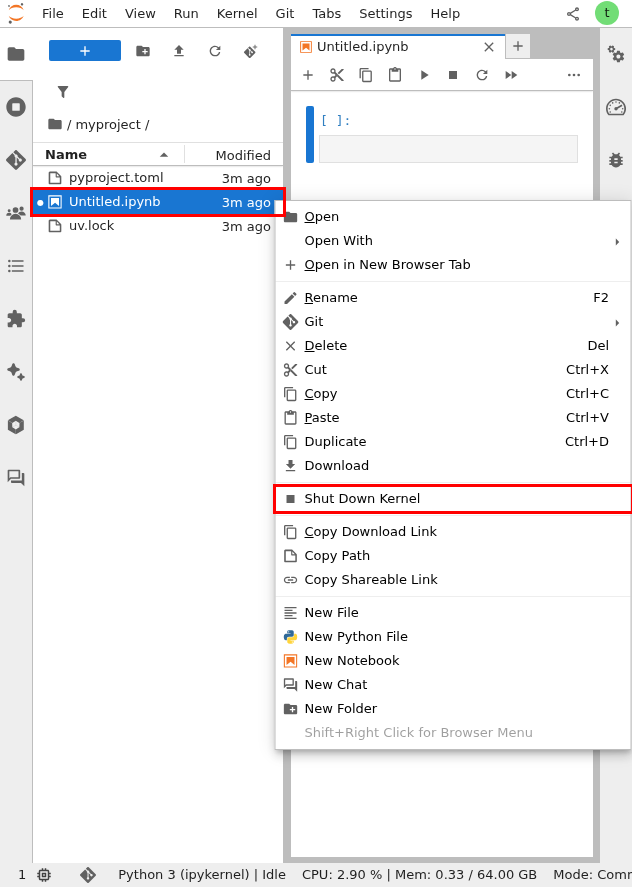{width="300"}](images/kernel-shutdown.png){target="_blank"}

    Then reopen the notebook and pick the new kernel from the kernel selector at the top right:

    [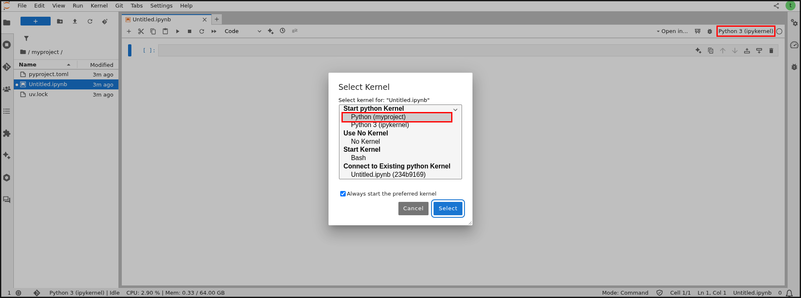{width="300"}](images/kernel-select.png){target="_blank"}

4.  In a terminal, run scripts with `uv run python myscript.py` inside `~/myproject`, or activate the environment with `source ~/myproject/.venv/bin/activate`. While it is activated, `pip install` also installs into it (prefer `uv add`, which records the package in `pyproject.toml`).

5.  To recreate the environment from scratch, e.g. on another computer or if it ever breaks:

    ``` bash
    cd ~/myproject
    rm -rf .venv
    uv venv --managed-python
    uv sync
    ```

uv keeps downloaded packages in `~/.cache/uv`; `uv cache clean` frees that space.

#### Using conda

Only if you need packages that are not Python packages (e.g. R, or libraries only on conda-forge); conda ships with Neurodesktop. Named environments are stored in `~/conda-environments`. Run `conda init` once and open a new terminal, then:

``` bash
conda create -n myproject python=3.12 numpy pandas ipykernel
conda activate myproject
python -m ipykernel install --user --name myproject --display-name "Python (myproject)"
conda env export -n myproject > ~/myproject/environment.yml    # to recreate it: conda env create --file ...
```

`conda clean --all` frees the space of downloaded packages.

## Resource (esp. RAM) usage {#resource-esp.-ram-usage}

Please keep an eye on your resource usage, especially RAM.

Your own usage and limit are shown in the status bar at the bottom of JupyterLab, e.g. `CPU: 12 % | Mem: 3.1 / 64.00 GB`. It counts everything you started, including the desktop and its apps. If you use more memory than your limit, the program using the most memory is stopped at once.

All users together share the server's memory. If it is used up, the server stops the program using the most memory, even if it was started first. For computations that run for many hours, save intermediate results.

The overall resource usage on the server (all users) is displayed in the bottom left of the neurodesktop interface as blue and red bars:

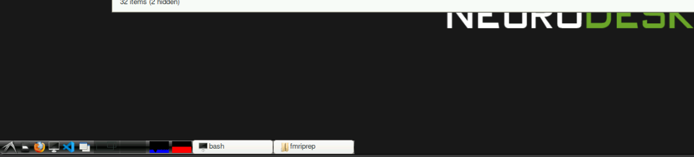

If you want to check which of your programs use how much, open the terminal and type "htop" (you can use F6 to sort processes by "percentage memory"). htop shows the whole server's memory and CPU cores, not your limit:

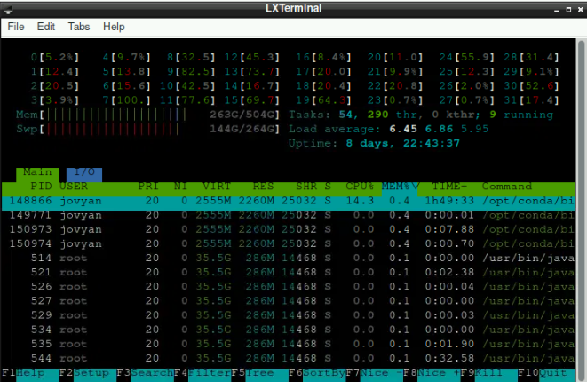

Most programs use as many cores as you have (6 or 30), and `nproc` reports that number. Others count all cores of the server and start too many threads; tell those how many to use, e.g. `fmriprep --nthreads 6 --omp-nthreads 6`, or `maxNumCompThreads(6)` in MATLAB.

## Using notebooks and scripts in JupyterLab

### Settings

When you want to use python scripts or notebooks, you'll probably set them up in JupyterLab. There are a few "nice-to-have" (e.g. changing the Theme at the section `Settings` at the menu bar) but also potentially crucial settings that are worth taking a look at:

`Settings > Settings Editor`

a)  at the sidebar, go to `Notebook`. Here you have the option to individualize different aspects about your notebooks. Two potentially important/helpful adaptations:
    1)  Enable "Auto Closing Brackets" (should be right at the top). When handling multiple brackets, this might be helpful to keep track of where you are.
    2)  If you scroll down a bit, there should be "Shut down kernel". Even though unused kernels are shut down after 24h automatically, it might be a good practice to enable this option. This results in an automatic kernel-shutdown whenever you close a notebook. This helps to keep the RAM clean by avoiding active kernels that are not used.
b)  at the sidebar, go to `Code Completion`. Depending what you are used to when coding, you can activate the option `Enable autocompletion` here

### Signs

- The ⏩ sign: $\to$ by clicking this button at the top of notebooks, it will restart the kernel and run the whole notebook sequentially (so all cells after each other)

- The ⏵ sign: run the current cell (Alternative: `Strg` + `Enter`)

- The ⏹ sign: interrupts all current processes of the kernel

- The ⟳ sign: restarts the kernel (*all* variables are lost, everything is cleared from RAM)

### Ensuring limited strain on RAM for notebooks with high RAM demands

- Sometimes you need to run notebooks that take some time and that require much RAM (e.g. analysis/processing with surface images of multiple subjects). First, you should figure out how many subjects are even possible at once (due to limited RAM). If you run a notebook that takes so much time that you potentially can't look at the data immediately (as it may take an hour and you are not in the office then), it can be useful to add cell at the very end of your notebook with `os._exit(0)` (if you don't use `os` in your notebook, you have to include `import os` before that line as well). Including this line and with using ⏩, your notebook runs through completely and automatically aborts the kernel afterwards. Thus, you free up the required RAM immediately after your notebook finished (obviously, you must make sure that the data you need is saved in the process)

# Information for lab members with ssh access

## Folder mappings

(left is server right is neurodesk)\
`/home/neurodesk/users/{username}` → `/home/jovyan` (SSD, 200 GB quota, students 100 GB)\
`/storage/neurodesk/users/{username}` → `/personal_storage` (linked as `~/personal_storage`)\
`/storage/neurodesk/users` → `/shared/people` (read-only; admins, instructors, researchers)\
`/storage/neurodesk/shared/research` → `/shared/research` (read-only for students)\
`/storage/neurodesk/shared/teaching` → `/shared/teaching`\
`/storage/neurodesk/shared/scratch` → `/shared/scratch` ⚠ Content is deleted after 2 weeks\
`/storage/neurodesk/shared/licenses` → `/shared/licenses` (read-only)\
`/storage/neurodesk/shared/software` → `/shared/software` (read-only for everyone; install as root)

Only `/home/jovyan`, `/personal_storage` and `/shared/*` are persistent in the container. The rest of `/storage` is no longer visible inside neurodesk. To work with data from there, copy it into your personal storage or `/shared/research` from an ssh session.

Files you create in neurodesk belong to your server account if your neurodesk username is the same as your server login; otherwise each user has a numeric uid of their own (1000000 and up).

## Checking resource usage directly on the server

### General

- resource usage per neurodesk container

``` bash
docker stats
```

- per user and process

``` bash
htop
```

### Storage

Check for available storage space

``` bash
df -h
```

Identify large files and folders

``` bash
ncdu -f "$(ls -1t /var/log/ncdu/root-*.ncdu | head -n1)"
```
