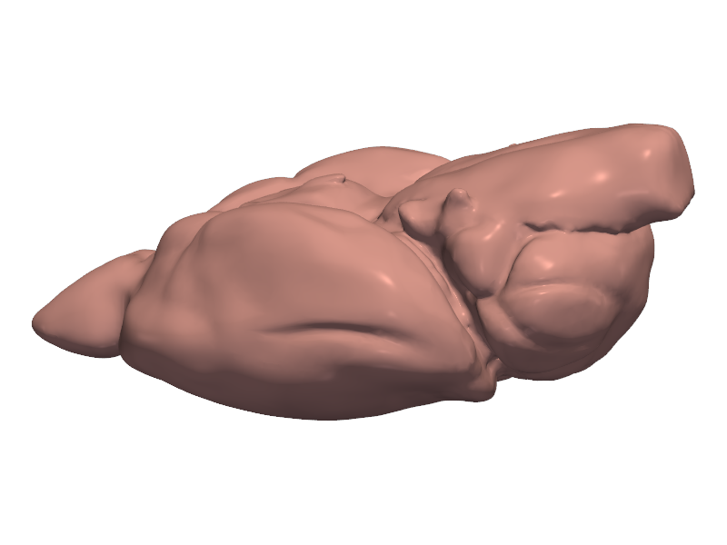
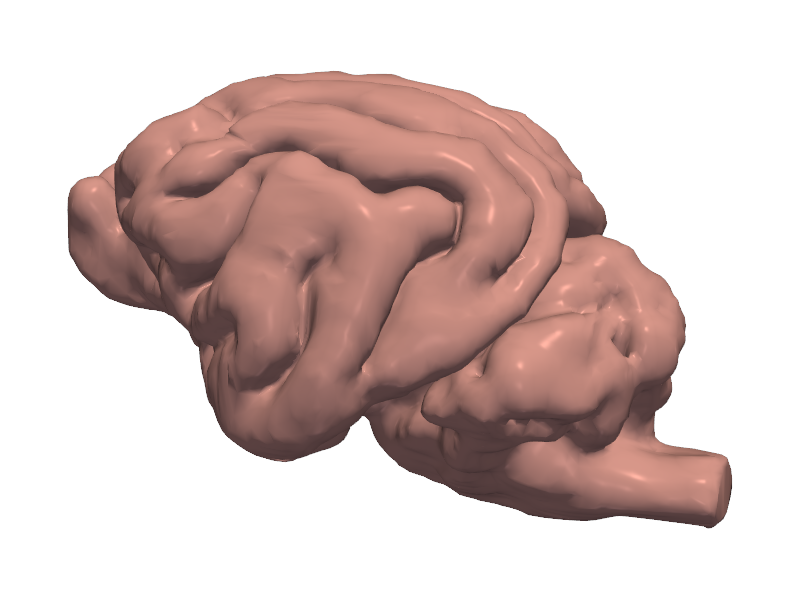
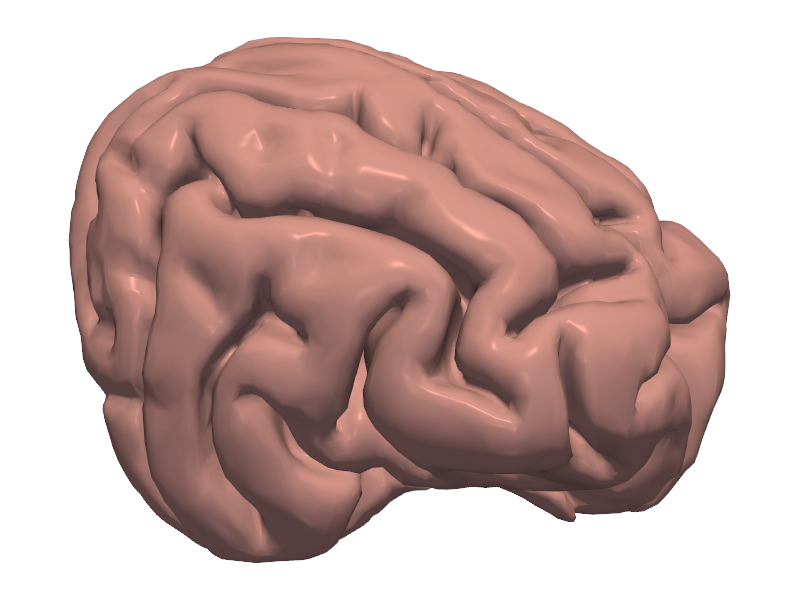
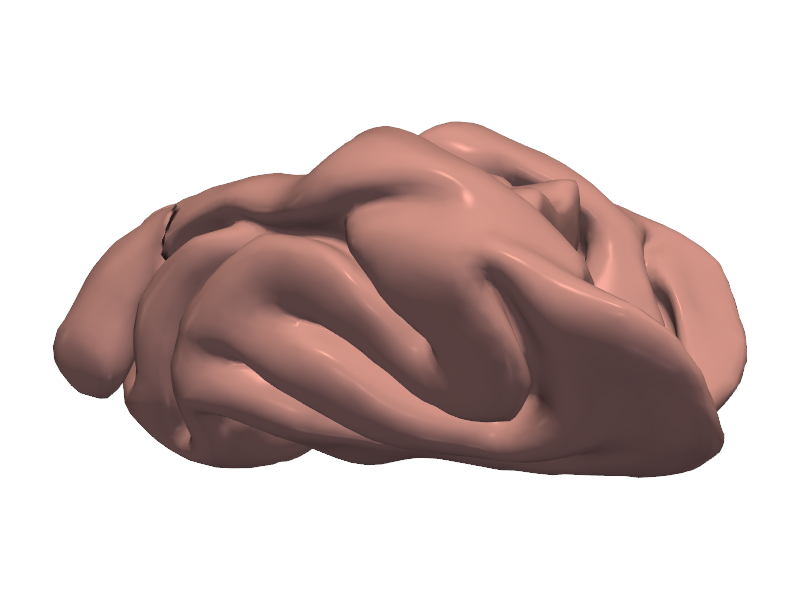
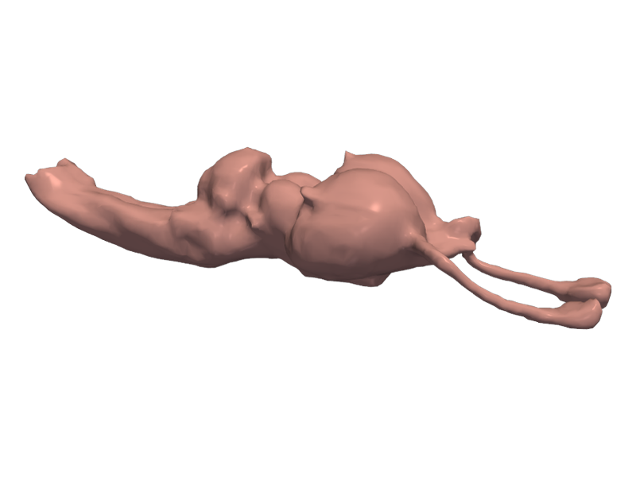
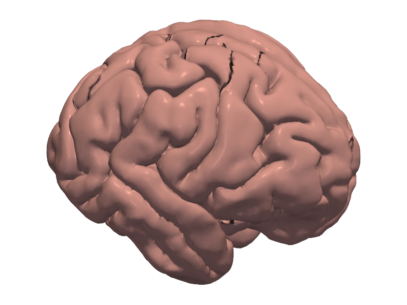

STL files of brain models we have printed.

| Preview | Brain | Download | Source |
| --- | --- | --- | --- |
| {width=200} | Mouse | [STL (42 MB)](files/Mouse_Brain.stl){download="Mouse_Brain.stl"} | [Thingiverse](https://www.thingiverse.com/thing:3079327) |
| {width=200} | Cat | [STL (1.9 MB)](files/cat-fixed.stl){download="cat-fixed.stl"} | |
| {width=200} | Cheetah | [STL (1.3 MB)](files/cheetah.stl){download="cheetah.stl"} | |
| {width=200} | Ferret | [STL (1.0 MB)](files/furet.stl){download="furet.stl"} | |
| {width=200} | Nile crocodile | [STL (0.5 MB)](files/nile-crocodile.stl){download="nile-crocodile.stl"} | |
| {width=200} | Orangutan | [STL (5.0 MB)](files/orangutan.stl){download="orangutan.stl"} | |
